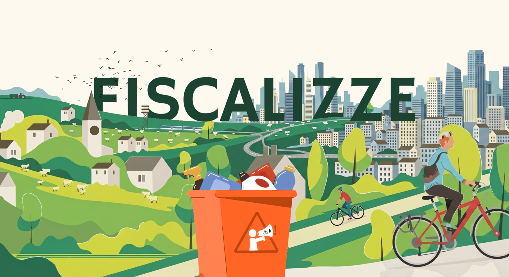
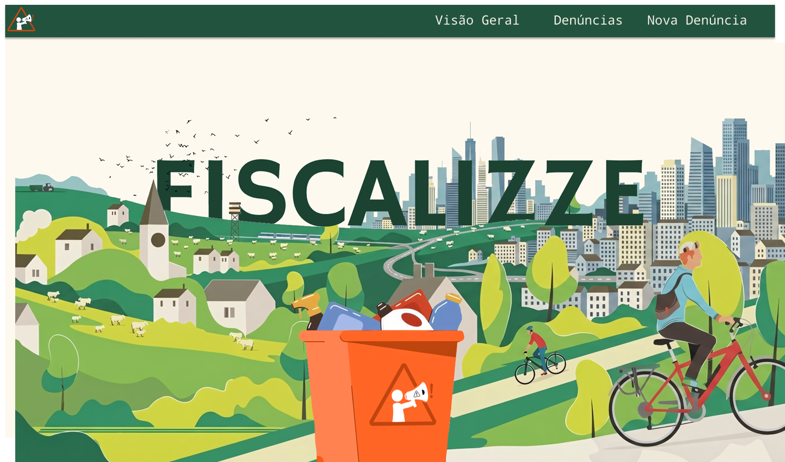
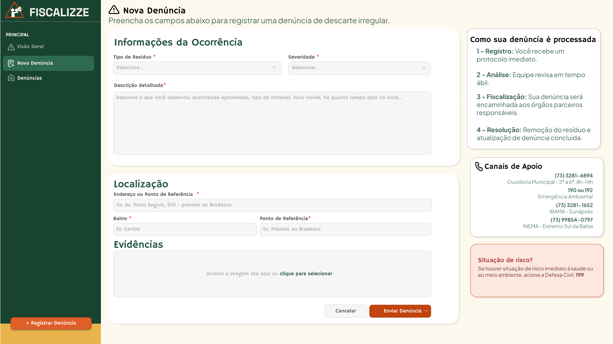
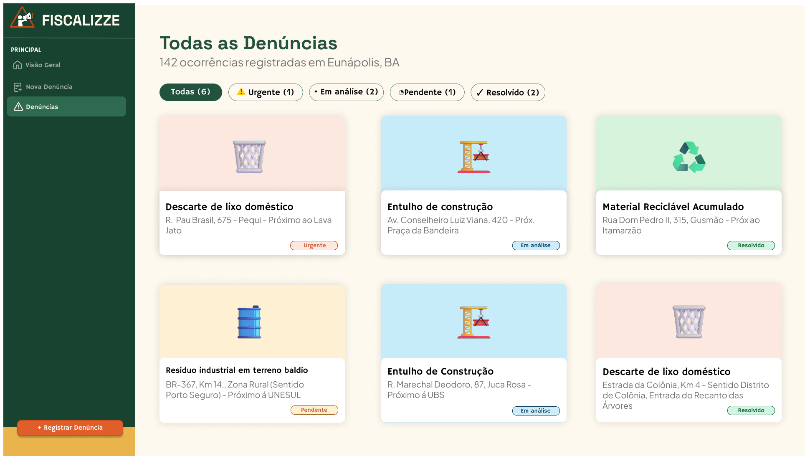

<div align="center">
  

  # ♻️ FISCALIZZE

  **Sistema de registro e acompanhamento de denúncias de descarte irregular de resíduos**

  Projeto acadêmico de Análise e Desenvolvimento de Sistemas (ADS), voltado à conscientização ambiental em **Eunápolis, Bahia**.
</div>



##  Sobre o projeto

O **FISCALIZZE** é um protótipo de plataforma web que permite registrar ocorrências de descarte irregular de resíduos, consultar registros e visualizar estatísticas. A proposta é estimular a participação da comunidade na preservação ambiental.

## Fundamentação e objetivos

O descarte irregular de resíduos é o problema investigado pelo grupo em Eunápolis. A proposta busca apoiar participação cidadã e conscientização ambiental por meio de registros padronizados. A existência, acessibilidade e adequação dos canais oficiais e as dificuldades da população precisam ser verificadas; não se presume ausência de atendimento municipal.

**Objetivo geral:** desenvolver e validar uma proposta de plataforma web para registro e acompanhamento de descarte irregular e conscientização ambiental.

**Objetivos específicos:** investigar canais e necessidades locais; definir campos essenciais; prototipar interfaces; organizar requisitos e regras; avaliar a prova de conceito; planejar conteúdos educativos e informações de ecopontos.

## Público-alvo e responsabilidades previstas

- Cidadãos de Eunápolis, especialmente moradores e estudantes: registrar e acompanhar ocorrências.
- Responsável pela fiscalização: analisar, encaminhar, atualizar status e registrar providências.
- Administrador: gerenciar usuários, categorias e relatórios.

Os dois últimos perfis são planejados; nenhuma permissão é implementada atualmente.

## Escopo e situação atual

A versão inicial contempla resíduos em geral; o comparativo posterior enfatiza entulhos. O código inclui lixo doméstico, entulho, recicláveis, resíduos industriais, poda e outros. Propõe-se manter o escopo amplo com entulho como foco de investigação, sujeito a aprovação do grupo. Educação ambiental e ecopontos permanecem planejados.

| Recurso | Situação |
|---|---|
| Navegação, formulário, lista, filtros por status e indicadores | Implementados localmente |
| Identificador FZ- baseado em Date.now() | Implementado localmente; não é protocolo oficial nem garante unicidade global |
| Fotos | Prévia de até quatro; sem persistência |
| Atualização de status | Simulação sem permissões |
| Busca por protocolo, autenticação, histórico, notificações, mapa, ecopontos e conteúdos educativos | Planejados |
| Banco de dados e integração municipal | Fora da entrega atual |

O código atribui Pendente ou Urgente inicialmente; a regra RN05 original prevê Recebida. A divergência está documentada para revisão futura.

## Documentação acadêmica

- [Casos de uso](docs/casos-de-uso.md)
- [Fundamentacao](docs/fundamentacao.md)
- [Historias de usuario](docs/historias-de-usuario.md)
- [Pesquisa de campo](docs/pesquisa-de-campo.md)
- [Planejamento](docs/planejamento.md)
- [Regras de negocio](docs/regras-de-negocio.md)
- [Requisitos funcionais](docs/requisitos-funcionais.md)
- [Requisitos nao funcionais](docs/requisitos-nao-funcionais.md)
- [Requisitos usuario](docs/requisitos-usuario.md)

##  Protótipos de interface (Figma)

[Acessar protótipo original no Figma](https://www.figma.com/proto/pbu9orzMmfK0CcfuyDV5eB/Telas?node-id=20-20&t=9mTG2gj8MTeamceg-1).

As imagens abaixo são **referências de design do Figma**, não capturas da aplicação em execução.

### Página inicial


### Estatísticas


### Nova denúncia


### Denúncias


##  Tecnologias

- **HTML5:** estrutura da interface.
- **CSS3:** layout e estilos.
- **JavaScript:** interações, filtros, cálculos e persistência local.
- **Figma:** prototipação visual.
- **Git e GitHub:** versionamento e hospedagem do código.

##  Como executar

1. Clone o repositório:

   ```bash
   git clone https://github.com/roannarv-rrv/FISCALIZZE.git
   ```

2. Abra a pasta `FISCALIZZE` no Visual Studio Code.
3. Abra o arquivo `index.html` no navegador ou utilize a extensão **Live Server**.

> **Observação:** nesta versão, as seções são acessadas por navegação interna no `index.html`.

##  Estrutura do projeto

```text
FISCALIZZE/
├── index.html
├── css/
│   └── estilo.css
├── js/
│   └── script.js
├── imagens/
│   ├── capa.png
│   └── logo.png
├── docs/
│   ├── arquivos de documentação (.md)
│   └── prototipos/
│       ├── pagina-inicial.png
│       ├── estatisticas.png
│       ├── nova-denuncia.png
│       └── denuncias.png
├── LICENSE
└── README.md
```

##  Limitações desta versão

- Os dados são salvos no **navegador de cada usuário**; não há banco de dados compartilhado.
- As fotos podem ser pré-visualizadas, mas **não são armazenadas** junto às denúncias.
- Os indicadores são calculados a partir dos registros salvos localmente e começam em zero.
- O projeto é um **protótipo acadêmico** e não representa um canal oficial de atendimento da prefeitura.

## Limites da revisão

Análise estática do ZIP enviado e dos três relatórios acadêmicos. Não foram executados testes de navegador nem verificados o Figma ao vivo ou o repositório remoto. Não há resultados de pesquisa de campo comprovados nos materiais.

##  Integrantes

- **Roanna Rodrigues Vieira**
- **Emanuel Henrique Rosa da Silva**
- **João Henrique Nonato Gonçalves**
- **Helen Santos Nascimento**
- **Marcio Neves Estavam Oliveira**
- **Richard Villela Aguiar**

**Curso:** Análise e Desenvolvimento de Sistemas (ADS)  
**Instituição:** Instituto Federal de Educação, Ciência e Tecnologia da Bahia - Campus Eunápolis 
**Disciplina:** Projeto Integrador  
**Orientador:** Professor Marcos Paranhos

---

<div align="center">
  <strong>FISCALIZZE — Sua voz por uma cidade mais limpa. 🌎</strong>
</div>
