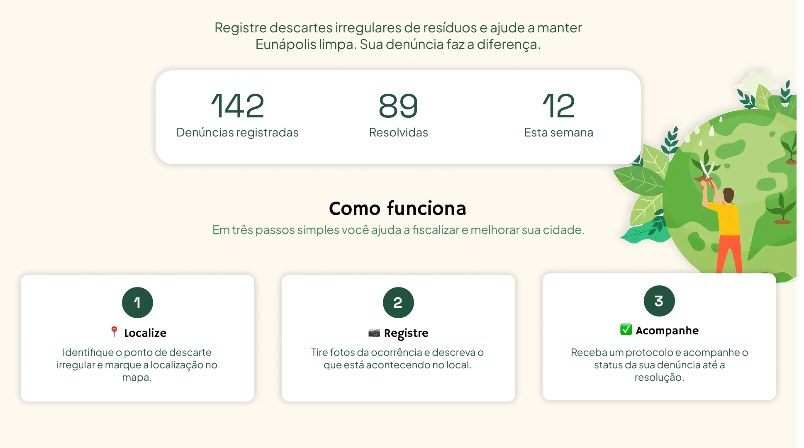

<div align="center">
  

  # ♻️ FISCALIZZE

  **Sistema de registro e acompanhamento de denúncias de descarte irregular de resíduos**

  Projeto acadêmico de Análise e Desenvolvimento de Sistemas (ADS), voltado à conscientização ambiental em **Eunápolis, Bahia**.
</div>


##  Sobre o projeto

O **FISCALIZZE** é um protótipo de plataforma web que permite registrar ocorrências de descarte irregular de resíduos, consultar registros e visualizar estatísticas. A proposta é estimular a participação da comunidade na preservação ambiental.

##  Funcionalidades

- Cadastro de denúncias com tipo, gravidade, descrição e localização.
- Pré-visualização de imagens selecionadas no formulário.
- Consulta e filtragem de denúncias por status.
- Atualização do status das ocorrências.
- Indicadores de denúncias cadastradas, resolvidas e registradas na semana.
- Armazenamento local dos registros no navegador com `localStorage`.

##  Protótipos de interface (Figma)

As imagens abaixo são **referências de design do Figma**, não capturas da aplicação em execução.

### Página inicial


### Estatísticas


### Nova denúncia


### Denúncias


##  Tecnologias

- **HTML5:** estrutura da interface.
- **CSS3:** layout e estilos.
- **JavaScript:** interações, filtros, cálculos e persistência local.
- **Figma:** prototipação visual.
- **Git e GitHub:** versionamento e hospedagem do código.

##  Como executar

1. Clone o repositório:

   ```bash
   git clone https://github.com/roannarv-rrv/FISCALIZZE.git
   ```

2. Abra a pasta `FISCALIZZE` no Visual Studio Code.
3. Abra o arquivo `index.html` no navegador ou utilize a extensão **Live Server**.

> **Observação:** nesta versão, as seções são acessadas por navegação interna no `index.html`.

##  Estrutura do projeto

```text
FISCALIZZE/
├── index.html
├── css/
│   └── estilo.css
├── js/
│   └── script.js
├── imagens/
│   ├── capa.png
│   └── logo.png
├── docs/
│   └── prototipos/
│       ├── pagina-inicial.png
│       ├── estatisticas.png
│       ├── nova-denuncia.png
│       └── denuncias.png
├── LEIA-ME.txt
└── README.md
```

##  Limitações desta versão

- Os dados são salvos no **navegador de cada usuário**; não há banco de dados compartilhado.
- As fotos podem ser pré-visualizadas, mas **não são armazenadas** junto às denúncias.
- Os indicadores são calculados a partir dos registros salvos localmente e começam em zero.
- O projeto é um **protótipo acadêmico** e não representa um canal oficial de atendimento da prefeitura.

##  Integrantes

- **Roanna Rodrigues Vieira**
- **Emanuel Henrique Rosa da Silva**
- **João Henrique Nonato Gonçalves**
- **Helen Santos Nascimento**
- **Marcio Neves Estavam Oliveira**
- **Richard Villela Aguiar**

**Curso:** Análise e Desenvolvimento de Sistemas (ADS)  
**Instituição:** Instituto Federal de Educação, Ciência e Tecnologia da Bahia - Campus Eunápolis 
**Disciplina:** Projeto Integrador  
**Orientador:** Professor Marcos Paranhos

---

<div align="center">
  <strong>FISCALIZZE — Sua voz por uma cidade mais limpa. 🌎</strong>
</div>
