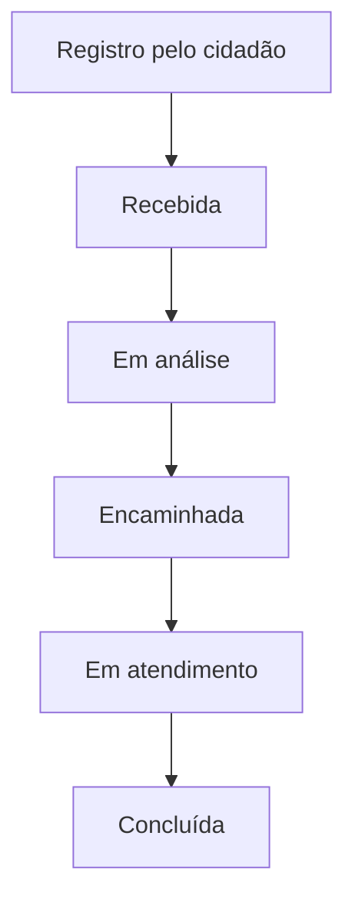

# Casos de uso e fluxo proposto

Base: segundo semestre, seção 3; comparativo final, páginas 4–6. Atores previstos: cidadão, responsável pela fiscalização e administrador. A versão simplificada do comparativo concentra-se no cidadão; o diagrama da página 13 do segundo semestre apresenta três atores. Não confundir os dois escopos.

| ID | Caso | Prova de conceito | Futuro |
|---|---|---|---|
| UC00 | Cadastro e criação de perfil | Ausente | Cadastro, validação e autenticação; decidir necessidade de CPF (RF01 menciona CPF, fluxo UC00 não). |
| UC01 | Visualização da página inicial | Navegação e estatísticas locais, sem login | Definir acesso público ou autenticado. |
| UC02 | Registro de denúncia | Formulário, persistência local, confirmação e identificador | Conta autenticada, anexos persistentes, encaminhamento. |
| UC03 | Acompanhamento do status | Lista local e filtros, sem histórico | Consulta individual, histórico e retorno oficial. |

## Fluxo futuro (RN05–RN07)

Apenas fiscalização/administração autorizada atualiza status. O código atual usa Pendente, Urgente, Em análise e Resolvido, sem controle de transições. Recomenda-se separar urgência (gravidade) de andamento em evolução futura; não alterar a regra original silenciosamente. Consulta por protocolo é extensão proposta, ainda não implementada.
